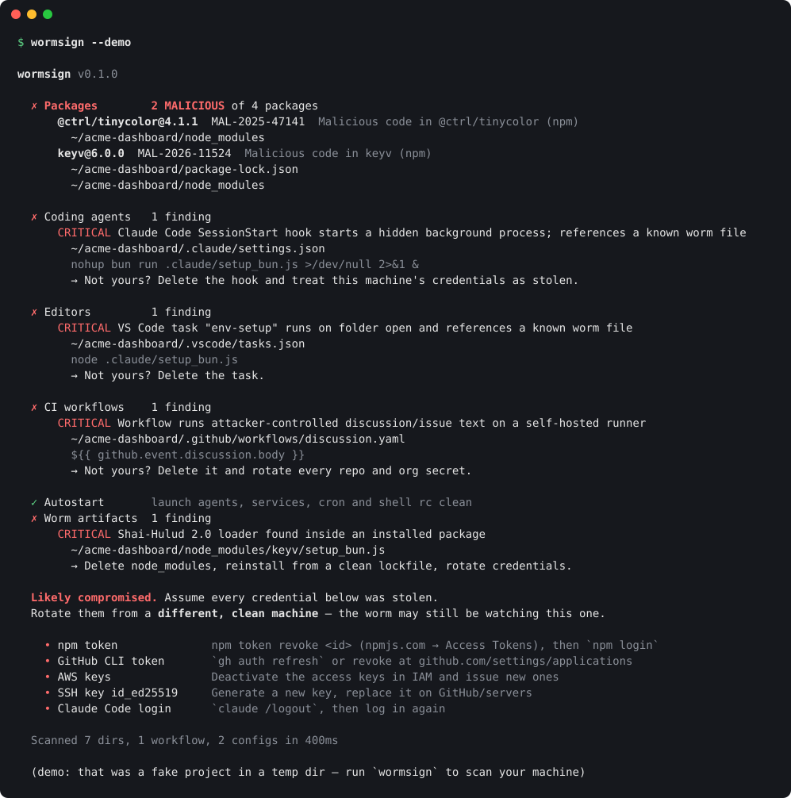

<p align="center"></p>

<h1 align="center">wormsign</h1>

<p align="center">Checks a developer machine for npm and PyPI supply-chain worms.</p>

<p align="center">
  <a href="https://github.com/mansoor-mamnoon/wormsign/actions/workflows/ci.yml"></a>
  <a href="https://github.com/mansoor-mamnoon/wormsign/releases"></a>
  
  <a href="LICENSE"></a>
</p>

<p align="center"></p>

Since September 2025, self-spreading worms (Shai-Hulud, Mini Shai-Hulud, SANDWORM_MODE,
ChainDrop) have stolen npm and GitHub tokens and republished themselves into hundreds of
packages. ChainDrop alone infected over 400 packages in four hours in August 2026. After each
outbreak, developers are told to check whether they installed an affected version.

`wormsign` does that check for every project in your home directory in one command. It reads
every lockfile and installed package tree, compares each version with the OSV.dev malware feed,
and looks for the hooks, tasks and services these worms install to run again later. A scan of
29,000 directories and 235 lockfiles takes about 12 seconds on a laptop.

## Install

```sh
brew install mansoor-mamnoon/tap/wormsign
```

Or download the release binary. The script verifies its SHA-256 checksum; it is under 60 lines.

```sh
curl -fsSL https://raw.githubusercontent.com/mansoor-mamnoon/wormsign/main/install.sh | sh
```

Or build it with Go 1.22 or later:

```sh
go install github.com/mansoor-mamnoon/wormsign@latest
```

Windows builds are on the [releases page](https://github.com/mansoor-mamnoon/wormsign/releases).

wormsign is not published to npm. A tool that checks for npm compromise should not need
`npm install` to run. It is one static Go binary with no dependencies.

## Usage

```sh
wormsign            # scan your home directory
wormsign --demo     # scan a harmless fake infected project to see a detection
wormsign ~/code     # scan one directory, plus machine-wide checks
```

Exit status is 0 when nothing critical is found, 1 when something is, and 2 on an error,
including when OSV.dev cannot be reached.

## Checks

| Check | What it reads | Why |
|---|---|---|
| Packages | Lockfiles from npm, yarn 1 and 2+, pnpm 5 to 9, bun, pip, poetry, uv, pdm and pipenv; `node_modules` and `site-packages`; global npm, pnpm and bun installs; the npx cache; pipx and uv tools | Each version is looked up in the [OSV.dev](https://osv.dev) malicious-package feed (`MAL-*` ids, which include GitHub malware advisories). New campaigns appear there within hours, so wormsign carries no package list of its own. |
| Coding agents | Claude Code hooks; MCP server configs for Claude Code, Claude Desktop, Cursor, VS Code, Windsurf, Codex, Gemini CLI, Zed, Kiro and others | Recent worms add a `SessionStart` hook or an MCP server so their payload runs each time the agent starts. |
| Editors | `.vscode/tasks.json` tasks with `runOn: folderOpen` | Opening the folder runs the task. |
| CI workflows | `.github/workflows/*` | Worms commit workflows that dump `toJSON(secrets)` or run discussion text on a self-hosted runner. |
| Autostart | macOS LaunchAgents, systemd user units, XDG autostart, crontab, shell rc files | ChainDrop installs a `gh-token-monitor` service that keeps stealing tokens after the package is removed. |
| Payload files | `setup_bun.js`, `bun_environment.js`, TruffleHog caches, staging directories | Their presence means the payload ran. |
| Credentials | npm, GitHub CLI, AWS, GCP, Azure, Docker, Kubernetes, PyPI, Cargo, SSH keys, Claude Code and Codex logins, secret-named environment variables | When a finding is critical, the report lists the credentials on this machine to rotate and how. |

The agent, editor and autostart checks match behavior: piping a download into a shell, inline
`node -e`, reading `.npmrc`, posting to webhook services, running from a temp directory. A
worm that renames its files still trips them. One known worm file or C2 domain makes a finding
critical. A single generic behavior, such as `curl | sh` in a task, is a warning; two together
are critical.

## Data sent over the network

wormsign sends `(ecosystem, package name, version)` triples to `api.osv.dev`, the same request
`osv-scanner` makes. It sends no paths, file contents or telemetry. Credentials are detected
by file presence and key names; their values never appear in the output.

`wormsign --offline` runs every local check and makes no network requests.

## CI

The GitHub Action fails a build when a lockfile pins a known-malicious version or the
repository contains worm persistence:

```yaml
- uses: actions/checkout@v4
- uses: mansoor-mamnoon/wormsign@v0
  # with:
  #   path: .
  #   args: --strict   # fail on warnings too
```

`wormsign --project .` runs the same scan locally. It reads only the given directory and
skips global installs, user-level agent configs, autostart entries and the credential list.

## Flags

```
wormsign [flags] [path ...]     default path: your home directory

  --demo        scan a harmless fake infected project
  --project     scan only the given paths; skip machine-wide checks
  --offline     skip the OSV.dev lookup
  --json        print results as JSON
  --strict      exit 1 on warnings too
  --all-vulns   also report ordinary CVEs (off by default)
  --no-globals  skip global installs and the npx cache
```

## Comparison with other tools

`npm audit` checks the npm tree of the project you run it in. wormsign checks every project on
the machine, covers PyPI, and reads global installs and the npx cache. It also finds hooks,
tasks and services that remain after the bad package is upgraded.

osv-scanner, Socket and Snyk keep bad packages out of a project before and during install.
wormsign is for the day a worm is announced: it tells you whether this machine was hit and
which credentials to rotate.

## False positives

A warning asks a person to look. A repo-level `SessionStart` hook can be legitimate, and it is
also the hook a worm adds. A finding is critical only with a known-malicious package version, a
known worm file, or two independent suspicious behaviors in the same command.

Please report false positives, misses and new campaign indicators in
[issues](https://github.com/mansoor-mamnoon/wormsign/issues).

## Limitations

- Bun's binary `bun.lockb` is not parsed. The text `bun.lock`, Bun's default since 1.2, is.
- The behavior checks can miss an attacker who avoids every pattern above. A clean result
  means no known indicators were found.
- wormsign is a triage tool. It does not monitor the machine. If it reports a compromise,
  rotate credentials from a different machine.

## License

MIT
