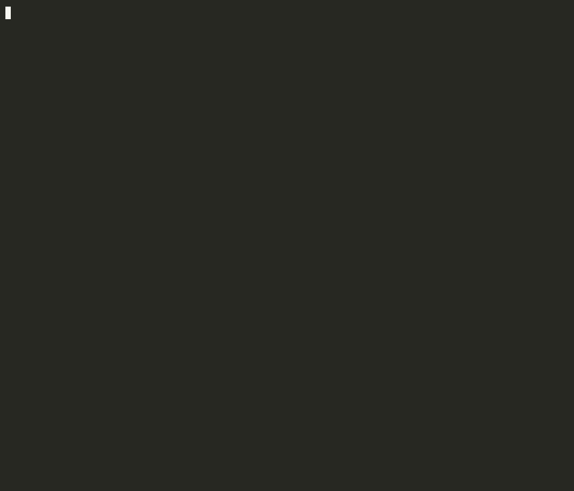

<p align="center"></p>

<h1 align="center">wormsign</h1>

<p align="center">Checks your machine for npm and PyPI worms like Shai-Hulud and ChainDrop.</p>

<p align="center">
  <a href="https://github.com/mansoor-mamnoon/wormsign/actions/workflows/ci.yml"></a>
  <a href="https://github.com/mansoor-mamnoon/wormsign/releases"></a>
  <a href="LICENSE"></a>
</p>

When ChainDrop got into 444 npm packages in August 2026, the advice was to check whether
you'd installed an affected version. On a laptop that's been in use for a while, that means
hundreds of lockfiles, plus global installs and the npx cache that MCP servers run from.
Upgrading the package also doesn't undo what it did. These worms add a Claude Code hook, a
VS Code task or a LaunchAgent so they run again later.

wormsign does that check in one pass. It looks up every installed package version in OSV's
list of known malware, then reads the config files and startup entries worms use to come
back. If it finds something, it lists the credentials on your machine that you'd need to
rotate.

```sh
brew install mansoor-mamnoon/tap/wormsign
wormsign
```

A scan of my laptop (about 4,500 packages) takes 7 seconds. `wormsign --demo` scans a fake
infected project in a temp folder, so you can see a detection without having one:

<p align="center"></p>

## Install

Homebrew is above. You can also download a release binary with this script, which checks
the file's SHA-256 before installing it:

```sh
curl -fsSL https://raw.githubusercontent.com/mansoor-mamnoon/wormsign/main/install.sh | sh
```

Or build it with Go 1.22 or later:

```sh
go install github.com/mansoor-mamnoon/wormsign@latest
```

Windows binaries are on the [releases page](https://github.com/mansoor-mamnoon/wormsign/releases).
It isn't published to npm.

## What it looks at

Packages: lockfiles from npm, yarn, pnpm, Bun, pip, poetry, uv and pipenv, the installed
`node_modules` and `site-packages` folders, global installs, the npx cache, and pipx and uv
tools. Each version is checked against [OSV](https://osv.dev), which lists known malware under
`MAL-` IDs.

Persistence: Claude Code hooks, MCP server configs (Claude, Cursor, VS Code, Windsurf, Codex
and others), VS Code tasks and dev container commands that run when a folder opens, GitHub
workflows that dump secrets, LaunchAgents, systemd user units, crontab and shell startup
files. It also looks for payload files that known worms drop, such as `setup_bun.js`.

A known worm file, domain or package version is reported as critical. Things that are only
suspicious, like `curl | sh` in a startup task, are warnings, since plenty of normal tools do
that too. Each report starts with CLEAN, REVIEW, DETECTED or PARTIAL. PARTIAL means part of
the scan failed or you used `--offline`.

A bad version in a lockfile doesn't prove the code ran, and a clean result only means nothing
known turned up.

## Privacy

Online scans send each package's name and version to api.osv.dev. That can include private
package names. Nothing else leaves your machine, and there's no telemetry. `--offline` skips
the lookup.

The terminal report shows the command behind a flagged hook or task with tokens and passwords
masked, so you can tell whether it's yours. JSON output and CI runs leave commands out.

## CI

```yaml
name: wormsign
on: [push, pull_request]
permissions:
  contents: read
jobs:
  scan:
    runs-on: ubuntu-latest
    steps:
      - uses: actions/checkout@v4
      - uses: mansoor-mamnoon/wormsign@v0
```

The action scans the repository only, fails the build on a critical finding, and writes the
report to the job summary. Pass `args: --strict` to fail on warnings too.

## Options

```text
--demo        scan a fake infected project
--project     scan only the given folders, skipping machine-wide checks (used by CI)
--offline     skip the OSV lookup
--json        print JSON
--strict      exit 1 on warnings too
--all-vulns   also report ordinary vulnerabilities
--no-globals  skip global installs and caches
```

It exits 0 when nothing critical is found, 1 when something is, and 2 when the scan couldn't
finish, for example when OSV is unreachable.

## Limits

It only knows about malware that's in OSV and the patterns in this repo, so a campaign
reported this morning may not be covered yet. The pattern checks can flag legitimate tools
and miss renamed payloads. It doesn't parse Bun's binary `bun.lockb`, and it doesn't check
Windows startup entries yet. It scans once and doesn't remove anything. If something ran,
rotate your credentials from a different machine.

If it flags something harmless or misses something real, please
[open an issue](https://github.com/mansoor-mamnoon/wormsign/issues).

## Development

```sh
go test -race ./...
go run . --demo
```

CI checks formatting with Go 1.27's `gofmt`. `scripts/render-demo.py` re-records
`docs/demo.gif` and needs [agg](https://github.com/asciinema/agg).

I wrote wormsign with a lot of help from Claude Code. Releases and their notes are on the
[releases page](https://github.com/mansoor-mamnoon/wormsign/releases). MIT license.
